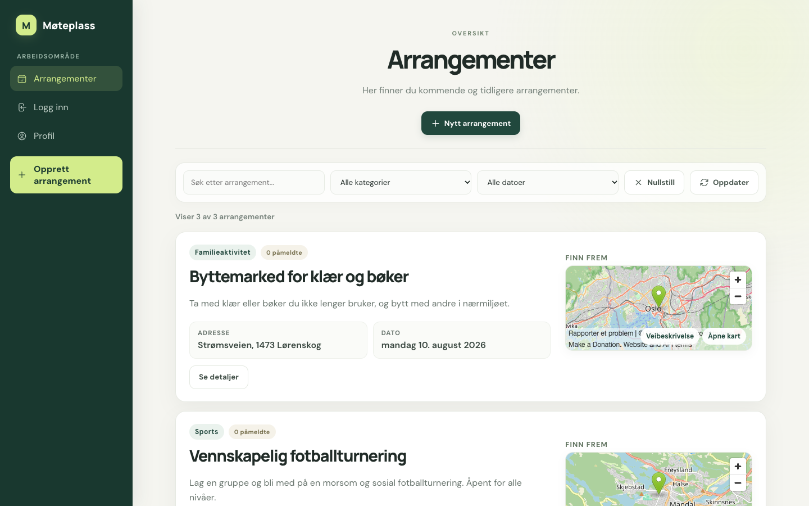
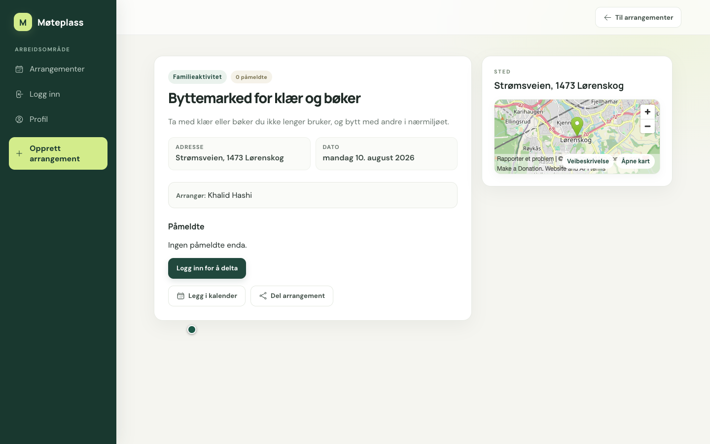
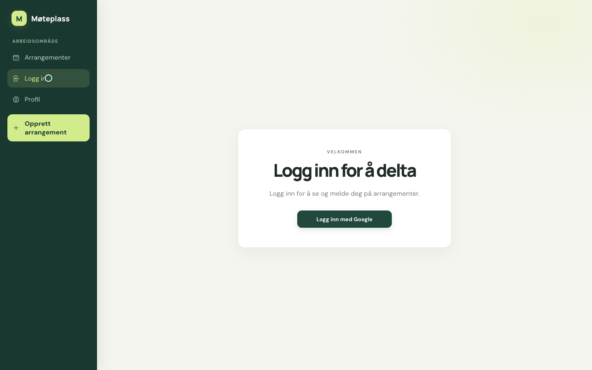
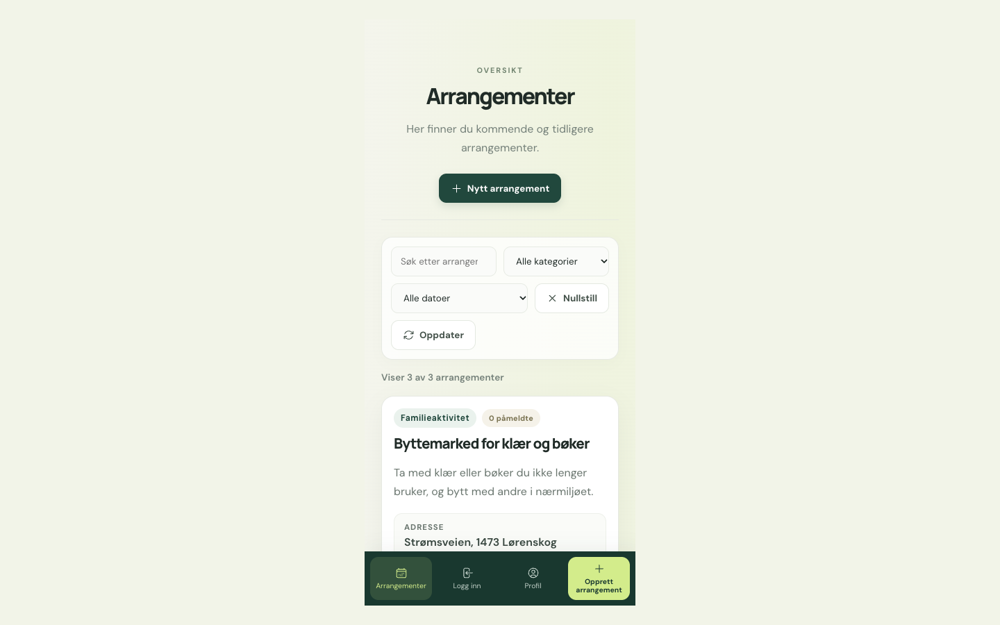

# Møteplass

[](https://github.com/Khhashi/eventhub/releases)


Fullstack-applikasjon for å opprette, finne og delta på arrangementer. Bygget med React og Vite i frontend, Express og MongoDB i backend, innlogging med Google OAuth og sanntidsoppdateringer med Socket.IO.

**[Live demo ↗](https://eventmeeting-f3eu.onrender.com/events)** | **[Arkitektur](docs/ARCHITECTURE.md)** | **[API-docs](docs/API.md)** | **[Bidrag](CONTRIBUTING.md)**

## Grensesnitt

<table>
  <tr>
    <td width="50%"><br />Arrangementsoversikt</td>
    <td width="50%"><br />Arrangementsdetaljer</td>
  </tr>
  <tr>
    <td width="50%"><br />Innlogging</td>
    <td width="50%"><br />Mobilvisning</td>
  </tr>
</table>

### Omvisning på mobil

<p align="center">
  
</p>

## Funksjoner

**For alle**
- Se, søke i og filtrere arrangementer
- Detaljer, adresse og kart for hvert arrangement

**Med innlogging**
- Melde seg på/av arrangementer
- Opprette, redigere og slette arrangementer
- Profil med egne arrangementer og påmeldinger
- Sanntidsoppdateringer når noen melder seg på

## Teknologi

React, React Router, Vite · Node.js, Express 5 · MongoDB, Mongoose · Google OAuth 2.0, JWT · Socket.IO · Vitest, Testing Library, Supertest · Render

## Kjør lokalt

Krever Node.js 20, MongoDB og Google OAuth-klient.

### Med npm

```bash
npm install
npm install --prefix server
npm install --prefix client
```

Opprett `server/.env` fra [.env.example](server/.env.example):

```bash
cp server/.env.example server/.env
```

Rediger `server/.env` med dine Google OAuth-verdier, så start:

```bash
npm run dev
```

Frontend: `http://localhost:5173` | Backend: `http://localhost:3000` | Tester: `npm test`

### Med Docker

```bash
docker-compose up
```

Samme som over, men MongoDB kjører i container. Se [docker-compose.yml](docker-compose.yml).

Frontend: `http://localhost:5173` | Backend: `http://localhost:3000`

## Sikkerhet og arkitektur

- **JWT i httpOnly-cookie** – Tokenet kan ikke leses av JavaScript
- **Tilgangskontroll på serveren** – Bare arrangøren eller admin kan endre arrangement
- **Socket.IO krever innlogging** – Bare innloggede får sanntidsoppdateringer
- **Robust feilhåndtering** – Graceful degradation ved feil (f.eks. ukjent adresse)

Se [arkitekturdokumentet](docs/ARCHITECTURE.md) for UML-diagrammer og designbeslutninger.

## Ressurser

- **[API-dokumentasjon](docs/API.md)** – Alle endepunkter og eksempler
- **[Bidragsguide](CONTRIBUTING.md)** – Hvordan bidra til prosjektet
- **[Sikkerhetspolicy](SECURITY.md)** – Rapporter sårbarheter
- **[Endringslogg](CHANGELOG.md)** – Versjonhistorikk
- **[Lisens](LICENSE)** – MIT
